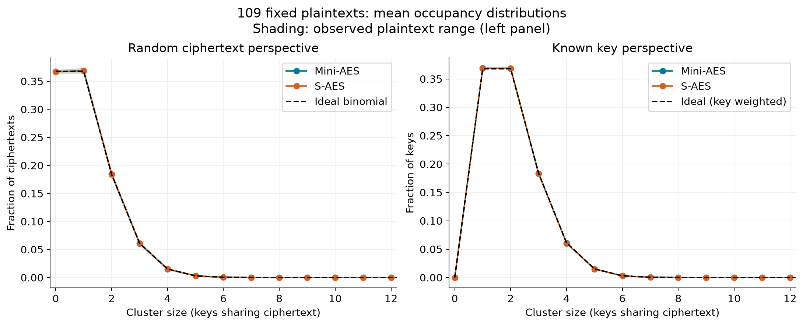
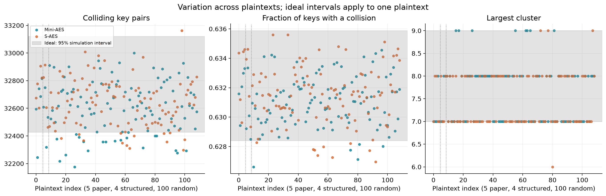

# Executed classical key-clustering study

Executed on 23 October 2026. Both ciphers: 109 distinct plaintexts × 65,536 keys, totaling **14,286,848 encryptions**. No Grover computation. All saved groups were reconstructed and compared with the encryption arrays.

## Main findings

| Across all 109 plaintexts | Mini-AES | S-AES | Ideal fixed-plaintext expectation |
|---|---:|---:|---:|
| Occupied ciphertexts (mean) | 41,492.44 | 41,472.55 | 41,426.84 |
| Keys in clusters ≥2 (mean fraction) | 0.631040 | 0.631496 | 0.632118 |
| Colliding key pairs (mean) | 32,606.03 | 32,641.94 | 32,767.50 |
| Largest observed cluster | 9 | 9 | Maximum is random; simulated 95% interval 7–9 |

Both ciphers have occupancy distributions close to the ideal binomial/Poisson(1) shape. Collisions are expected even in an ideal cipher: roughly 63.2% of keys share their observed ciphertext with another key. They do not by themselves establish equivalent full encryption functions, reduced master-key entropy, a practical attack, or a weakness relative to AES.

The means show modest, systematic departures from the ideal expectation (slightly more occupied ciphertexts and fewer colliding pairs). Thus “similar to ideal” does not mean “exactly ideal.” These are deterministic two-round toy ciphers, and these measurements do not establish pseudorandomness.

## Variation across plaintexts

| Metric | Mini-AES mean ± SD [min,max] | S-AES mean ± SD [min,max] |
|---|---|---|
| occupied_ciphertexts | 41492.4 ± 79.4484 [41324, 41660] | 41472.6 ± 84.0787 [41267, 41675] |
| fraction_keys_in_clusters_ge2 | 0.63104 ± 0.00172943 [0.626617, 0.634552] | 0.631496 ± 0.00198952 [0.626953, 0.63559] |
| colliding_key_pairs | 32606 ± 189.478 [32176, 33000] | 32641.9 ± 177.982 [32298, 33162] |
| max_cluster_size | 7.57798 ± 0.627953 [7, 9] | 7.48624 ± 0.571137 [6, 9] |

## Random-plaintext inference

The five paper and four structured plaintexts are deliberate choices. Inference below uses only the other 100: a simple random sample without replacement from the 65,527 remaining plaintexts. Intervals are approximate 95% Student-t intervals with finite population correction. They quantify uncertainty about each fixed cipher’s mean across that plaintext population, not across possible cipher designs. Paired intervals compare the same plaintexts. They are exploratory and not adjusted for multiple metrics.

| Population/metric | Random sample mean | Approximate 95% interval |
|---|---:|---:|
| mini_aes: occupied_ciphertexts | 41492.35 | [41476.65, 41508.05] |
| saes: occupied_ciphertexts | 41477.24 | [41460.84, 41493.64] |
| mini_minus_saes: occupied_ciphertexts | 15.11 | [-8.98, 39.20] |
| mini_aes: colliding_key_pairs | 32607.63 | [32569.98, 32645.28] |
| saes: colliding_key_pairs | 32633.87 | [32598.49, 32669.25] |
| mini_minus_saes: colliding_key_pairs | -26.24 | [-80.81, 28.33] |

The paired colliding-pair interval includes zero: this sample does not resolve a difference in mean pair collisions between the ciphers. Each cipher’s estimated mean pair count is below the ideal mean 32,767.5. Effect sizes, sampling design and interval assumptions matter more here than an unqualified significance label.

The 2,000 independent ideal occupancy simulations provide pointwise reference intervals for ONE plaintext. They are not simultaneous confidence bands across 109 plaintexts. Actual ciphers reuse keys and schedules across plaintexts; an ideal family also has within-key permutation constraints across distinct plaintexts. This project simulates the exact fixed-plaintext marginal, not a joint model of all plaintexts. No independent-plaintext ideal-model aggregate p-value is claimed.

## Paper reproduction

Source: Kiran et al. (2026), user PDF, Tables 9–11 on page 7. Every printed key is valid. Eight of nine printed groups are exhaustive. Table 11’s FF48→7492 group is actually {7E7C,F5E2}; the table lists only F5E2. All nine groups and exact flags appear in `results/paper_reproduction.csv`.

E0F7→8816 has exactly {A233,C0E4,E534}. The prose/table disagreements and the incorrect B→4 entry in the paper’s S-AES S-box are detailed in `SPECIFICATION.md`. The implementation uses authoritative S-AES B→3. The extra prose claim BAD0→E7AA under F5E2 does not reproduce: its ciphertext is 2568. The only key for BAD0→E7AA is 57A2. Phan’s original 9C63→72C6 example has exactly {98DD,C3F0,E873}, matching the 2026 paper’s separate example. These checks appear in `results/prose_checks.csv`.

## Correct ideal model and the two perspectives

Let N=65,536 ciphertext values and K=65,536 independently keyed random permutations. At one fixed plaintext, outputs across keys are independent uniform ciphertexts. This is balls into bins; it is NOT one permutation mapping keys onto ciphertexts. Let n_c be the number of keys yielding c and H_j the number of ciphertexts with n_c=j, including H_0.

- A random ciphertext sees n_c ~ Binomial(K,1/N), approximately Poisson(1). E[H_j]=N·Pr(n_c=j). Mean size is exactly 1, including empty groups. Expected occupied ciphertexts: N·[1−(1−1/N)^K].
- A uniformly random known key sees the size-biased group containing its own ciphertext: 1+Binomial(K−1,1/N), approximately 1+Poisson(1). Its expected size is 2−1/N. Probability of ≥2 is 1−(1−1/N)^(K−1), approximately 0.63212. This differs from a random nonempty ciphertext, which instead sees the binomial conditioned on ≥1.
- Colliding unordered key pairs: sum_c n_c(n_c−1)/2. Ideal expectation is choose(K,2)/N=32,767.5. Variance is choose(K,2)(1/N)(1−1/N); pair-match indicators are pairwise independent at a fixed plaintext, even when two pairs share a key.
- The ciphertext-weighted fraction in clusters ≥2 is 1−Pr(n_c=0)−Pr(n_c=1), approximately 0.26424. It must not be confused with the key-weighted fraction ≈0.63212.
- Empirically, keys in clusters ≥2 = K−H_1; known-key mean cluster size = sum_c n_c²/K = 1+2·pairs/K. Ciphertext entropy and expected log2 candidate count are also included in the metric CSV.

The binomial histogram bins are dependent because occupancies sum to K. Ordinary independent Poisson-bin chi-square assumptions are not used. Single-pair clusters are not proof of equivalent keys: equivalence requires agreement on every plaintext; testing surviving groups against further common plaintext/ciphertext pairs is a separate next phase.

## Reproducibility and limits

Seed 20261023; Python `random.Random(seed).sample` selects 100 distinct values from an ascending list excluding the nine fixed values. `results/plaintexts.csv` freezes the exact sample and order. Baseline uses NumPy PCG64 seed 20261024. Versions and input hash are recorded in the manifest.

Only two rounds and the specified conventions are studied. All-key enumeration is exhaustive for each selected plaintext, but all 65,536 plaintexts were not surveyed. Structured and paper cases are not a random population sample. Toy-cipher conclusions cannot be extrapolated to full AES or practical security. No relation analysis, equivalent-key classification, or quantum experiment is claimed.

Scalar and vector implementations are separate, but share the specification constants and field helper; the field helper has an independent polynomial-reduction test. Published vectors provide external validation. Five complete fixed-key plaintext permutations are checked for each cipher; that is not an exhaustive test of every key/plaintext combination.

